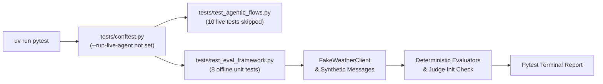
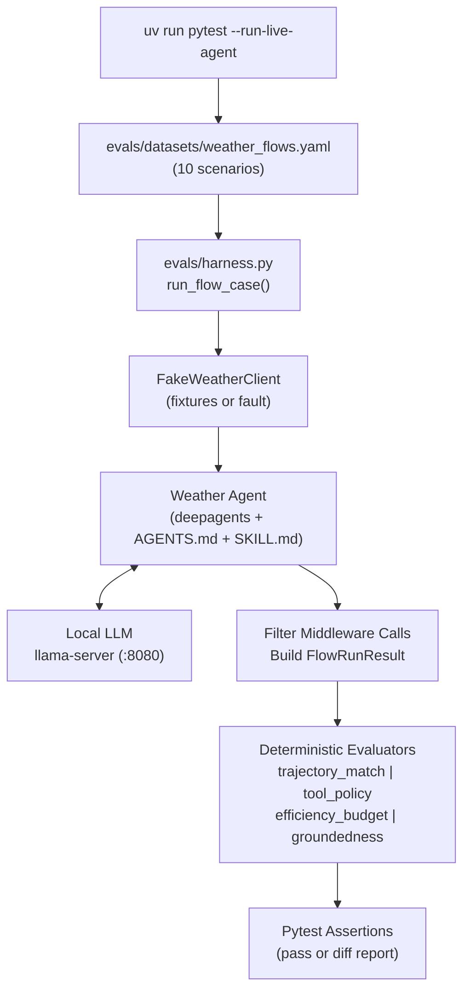
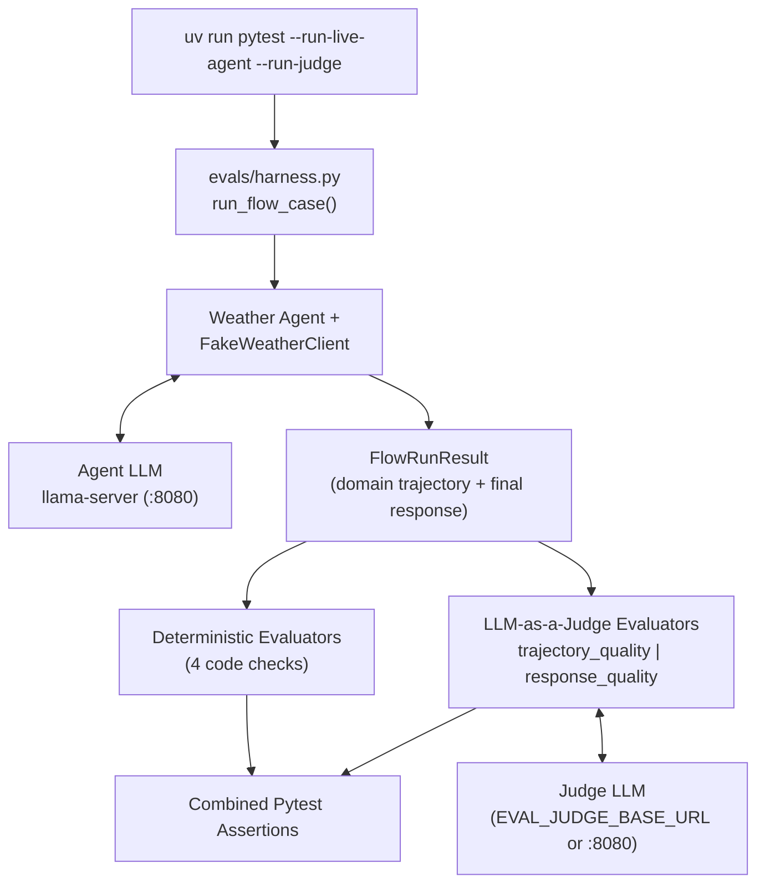
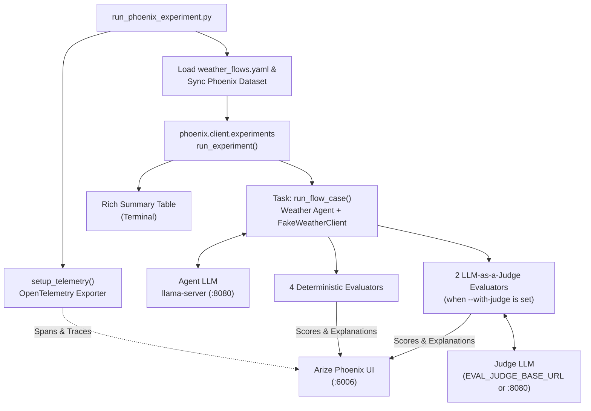

# Agentic Flow Evaluation Guide

This document describes the evaluation framework for the Weather Agent. It explains the test architecture, the custom dataset format, the deterministic evaluators, the LLM-as-a-Judge evaluators, the `pytest` configuration, and the Arize Phoenix integration.

## 1. Architecture Overview

The evaluation framework tests the complete execution path (trajectory) of the agent, not only the final text answer. It checks tool selection, tool arguments, multi-turn memory, error recovery, and output quality.

```text
evals/
├── fakes.py                        # Deterministic WeatherClient with fault injection
├── harness.py                      # Single-turn and multi-turn flow runner
├── datasets/
│   └── weather_flows.yaml          # Golden test scenarios (custom schema)
├── evaluators/
│   ├── deterministic.py            # Code-based evaluators (agentevals + custom checks)
│   └── llm_judge.py                # Rubric-based LLM-as-a-Judge evaluators (phoenix.evals)
└── run_phoenix_experiment.py       # Arize Phoenix Experiments CLI runner

tests/
├── conftest.py                     # Custom pytest CLI flags and test markers
├── test_eval_framework.py          # Offline unit tests for the evaluation code
└── test_agentic_flows.py           # Live end-to-end agent flow tests
```

The framework follows this execution sequence:

1. Load test scenarios from `evals/datasets/weather_flows.yaml`.
2. Create a `FakeWeatherClient` instance with fixed weather data or a simulated fault.
3. Pass the fake client to `create_weather_agent()` in `src/agent_evaluation/weather_agent.py`.
4. Run one or more user turns through the agent on a shared `thread_id`.
5. Filter out internal middleware tool calls and record only domain tool calls.
6. Grade the recorded run with deterministic evaluators and optional LLM-as-a-Judge evaluators.
7. Report results through `pytest` or upload them to Arize Phoenix.

## 2. Execution Flow Diagrams by Running Mode

The framework supports four running modes. Each diagram below shows the components that execute in that mode.

### Mode 1: Offline Framework Unit Tests

Command: `uv run pytest`

This mode tests the evaluation code itself. It does not call `llama-server`, Open-Meteo, or Arize Phoenix.



### Mode 2: Live Agentic Flows (Deterministic Only)

Command: `uv run pytest tests/test_agentic_flows.py --run-live-agent`

This mode runs all 10 golden scenarios through the real Weather Agent and grades only with deterministic code evaluators.



### Mode 3: Live Agentic Flows with LLM-as-a-Judge

Command: `uv run pytest tests/test_agentic_flows.py --run-live-agent --run-judge`

This mode adds semantic rubric grading after the deterministic checks.



### Mode 4: Arize Phoenix Experiments

Command: `uv run python -m evals.run_phoenix_experiment --experiment-name weather-v1 --with-judge`

This mode runs the same agent harness and evaluators, then stores datasets, scores, and OpenTelemetry traces in Arize Phoenix for UI inspection and comparison.



## 3. Deterministic Fake Environment (`evals/fakes.py`)

Live weather APIs return changing values and can fail unexpectedly. To make evaluations repeatable, `FakeWeatherClient` implements the `WeatherClient` protocol from `src/agent_evaluation/weather_client.py`.

### Built-In City Fixtures

`DEFAULT_CITY_FIXTURES` defines fixed weather conditions for five cities:

| City | Resolved Location | Description | Celsius | Fahrenheit |
| :--- | :--- | :--- | :--- | :--- |
| `madrid` | `Madrid, Spain` | `Clear sky` | `14.0°C` | `57.2°F` |
| `tokyo` | `Tokyo, Japan` | `Partly cloudy` | `20.0°C` | `68.0°F` |
| `london` | `London, United Kingdom` | `Moderate rain` | `11.0°C` | `51.8°F` |
| `berlin` | `Berlin, Germany` | `Overcast` | `8.0°C` | `46.4°F` |
| `paris` | `Paris, France` | `Mainly clear` | `16.0°C` | `60.8°F` |

City lookups are not case-sensitive. The client accepts short names (such as `Madrid`) and full names (such as `Madrid, Spain`).

### Simulated Errors and Fault Injection

`FakeWeatherClient` reproduces three error paths:

- **Unknown city**: Any city name that is not in `fixtures` raises `ValueError`.
- **Unsupported unit**: Any unit other than `celsius` or `fahrenheit` raises `ValueError`.
- **Service outage**: Set `fail_mode="service_outage"` to raise `RuntimeError` on every call.

`FakeWeatherClient` also stores every call in `call_log` for debugging.

## 4. Golden Flow Dataset (`evals/datasets/weather_flows.yaml`)

The file `evals/datasets/weather_flows.yaml` stores 10 single-turn and multi-turn test cases. These cases test the rules in `AGENTS.md` and `skills/weather/SKILL.md`.

### Custom Schema Design

The YAML format is custom to this project. Neither `pytest`, `agentevals`, nor Arize Phoenix requires this specific schema:

- `pytest` reads the file through `load_flow_cases()` in `evals/harness.py`.
- `agentevals` receives OpenAI-format message lists that `evals/evaluators/deterministic.py` builds from `expected_tool_calls`.
- Arize Phoenix receives flat JSON `inputs` dictionaries that `evals/run_phoenix_experiment.py` builds from each case.

You can add, rename, or remove YAML fields if you update the corresponding loader or evaluator.

### Field Reference

| Field | Required | Used By | Purpose |
| :--- | :--- | :--- | :--- |
| `id` | Yes | `harness.py`, `test_agentic_flows.py`, `run_phoenix_experiment.py` | Unique test case identifier. |
| `description` | No | `run_phoenix_experiment.py` | Short summary uploaded to Phoenix. |
| `category` | No | `run_phoenix_experiment.py` | Scenario group (for example, `happy_path`, `multi_turn`, `error_recovery`). |
| `turns` | Yes | `harness.py` | Ordered list of user messages sent to the agent. |
| `fake_client` | No | `harness.py` | Optional fake client settings (for example, `fail_mode: service_outage`). |
| `expected_tool_calls` | No | `deterministic.py` | List of expected domain tool calls with `name` and `args`. |
| `trajectory_match_mode` | No | `deterministic.py` | Match strategy for `agentevals`: `strict`, `unordered`, `subset`, or `superset`. Default is `unordered`. |
| `forbidden_tools` | No | `deterministic.py` | Domain tools that the agent must not call in any turn. |
| `turn_assertions` | No | `deterministic.py` | Per-turn rules with `turn_index` (0-based), `forbidden_tools`, and `required_tools`. |
| `max_tool_calls` | No | `deterministic.py` | Maximum number of domain tool calls permitted across all turns. |
| `allow_duplicate_calls` | No | `deterministic.py` | Set to `true` to allow identical tool calls in the same turn. Default is `false`. |
| `grounded_any_of` | No | `deterministic.py` | List of token groups. At least one token from each group must appear in the final response. |
| `forbidden_substrings` | No | `deterministic.py` | Strings that must not appear in the final response. |
| `rubric_criteria` | No | `llm_judge.py` | Evaluation criteria given to the LLM-as-a-Judge prompts. |

### How to Add a New Scenario

1. Open `evals/datasets/weather_flows.yaml`.
2. Add a new entry under `cases:` with a unique `id`.
3. Define `turns` (one string for single-turn, or multiple strings for multi-turn).
4. Add `expected_tool_calls`, `trajectory_match_mode`, `max_tool_calls`, `grounded_any_of`, and `rubric_criteria`.
5. Run the new test case with `pytest`:

```bash
uv run pytest tests/test_agentic_flows.py --run-live-agent -k your_new_case_id
```

## 5. Execution Harness (`evals/harness.py`)

`evals/harness.py` runs each scenario against the Weather Agent and collects structured trace data.

### Multi-Turn Execution

`run_flow_case()` creates one agent instance and one `thread_id` per test case. It calls `await agent.ainvoke(...)` for each prompt in `case["turns"]` in order. Because all turns share the same `thread_id`, LangGraph keeps conversation history between turns.

After each turn, the harness slices only the newly added messages (`messages[prev_count:]`). It stores each turn in a `TurnResult` object and returns a `FlowRunResult` with:

- `turns`: Per-turn user inputs, domain tool calls, responses, and latencies.
- `all_messages`: Full LangChain message history.
- `domain_tool_calls`: Flat list of `DomainToolCall(name, args, turn_index, call_id)`.
- `openai_trajectory`: OpenAI-format message list for `agentevals` and LLM judges.
- `final_response`: Text content of the last assistant message.
- `total_latency_seconds`: Total wall-clock time across all turns.

### Middleware Tool Filtering

`deepagents` attaches middleware (`MemoryMiddleware` and `SkillsMiddleware`) that calls internal filesystem tools such as `read_file` to load `AGENTS.md` and `skills/weather/SKILL.md`.

If an evaluator checked raw tool calls, internal middleware calls would break trajectory matching. To prevent false failures, `extract_domain_tool_calls()` and `to_openai_domain_trajectory()` filter messages against `DOMAIN_TOOLS = {"get_weather", "get_temperature"}`. Only domain tool calls and their matching `ToolMessage` responses enter the evaluated trajectory.

## 6. Deterministic Evaluators (`evals/evaluators/deterministic.py`)

Every evaluator returns an `EvalOutcome(name, passed, score, reason)`. `run_deterministic_evaluators()` executes four checks in sequence:

### 6.1 `trajectory_match`

Uses `agentevals.trajectory.match.create_trajectory_match_evaluator` to compare `run.openai_trajectory` against `expected_tool_calls`.

Supported `trajectory_match_mode` values:

- `strict`: Exact same domain tool calls in the exact same order.
- `unordered`: Exact same domain tool calls in any order.
- `subset`: Actual calls must be a subset of expected calls.
- `superset`: Actual calls must include at least all expected calls.

To avoid brittle string failures, the evaluator registers two custom argument matchers in `tool_args_match_overrides`:

- `get_weather`: Compares `city` in lowercase and strips country suffixes (so `Madrid, Spain` matches `Madrid`).
- `get_temperature`: Applies the same city normalization and normalizes `unit` (`C`, `°C`, `None` → `celsius`; `F`, `°F` → `fahrenheit`).

### 6.2 `tool_policy`

`evaluate_forbidden_and_turn_tools()` enforces hard policy rules:

- Checks overall `forbidden_tools` across all turns (for example, zero weather tool calls when the user asks *"What's the weather outside?"*).
- Checks each item in `turn_assertions` against `run.turns[turn_index]`. This verifies multi-turn rules such as forbidding tools on Turn 0 and requiring `get_weather` on Turn 1.

### 6.3 `efficiency_budget`

`evaluate_efficiency_budget()` detects runaway loops and wasted steps:

- Fails if `len(run.domain_tool_calls) > max_tool_calls`.
- Fails if the agent makes two identical normalized `(turn_index, tool_name, args)` calls in the same turn, unless `allow_duplicate_calls: true` is set.

### 6.4 `groundedness`

`evaluate_groundedness()` checks the final text answer without an LLM call:

- Fails if `final_response` is empty.
- Checks every list in `grounded_any_of` (case-insensitive substring match). At least one string in each list must appear in `final_response`.
- Fails if any string in `forbidden_substrings` appears in `final_response`.

## 7. LLM-as-a-Judge Evaluators (`evals/evaluators/llm_judge.py`)

Deterministic checks cannot grade tone, formatting, or nuanced honesty. `evals/evaluators/llm_judge.py` uses `arize-phoenix-evals` (`LLM` and `create_classifier`) to score semantic quality.

### Evaluators

1. `trajectory_quality`: Sends the JSON `openai_trajectory` and the case `rubric_criteria` to the judge. The judge outputs `pass` (`1.0`) or `fail` (`0.0`) with an explanation.
2. `response_quality`: Sends the user inputs, the `final_response`, and the `AGENTS.md` style guidelines to the judge. It checks tone, scannable formatting, groundedness, and honest error handling.

### Judge LLM Configuration

`build_judge_llm()` creates a `phoenix.evals.LLM(provider="openai", ...)` instance. It resolves connection settings in this order:

| Setting | Environment Variable Priority | Default |
| :--- | :--- | :--- |
| Base URL | `EVAL_JUDGE_BASE_URL` → `LLM_BASE_URL` | `http://localhost:8080/v1` |
| Model | `EVAL_JUDGE_MODEL` → `LLM_MODEL` | `local-model` |
| API Key | `EVAL_JUDGE_API_KEY` → `LLM_API_KEY` | `not-needed` |

By default, the judge uses your local `llama-server`. To grade with a stronger external or separate local model, export `EVAL_JUDGE_BASE_URL`, `EVAL_JUDGE_MODEL`, and `EVAL_JUDGE_API_KEY`.

## 8. `pytest` Configuration and Usage

### Project Configuration (`pyproject.toml` and `tests/conftest.py`)

`pyproject.toml` sets three `pytest` options under `[tool.pytest.ini_options]`:

- `pythonpath = ["."]` so `evals` imports cleanly without `PYTHONPATH=.`.
- `testpaths = ["tests"]` to limit test discovery to `tests/`.
- `asyncio_default_fixture_loop_scope = "function"` to match `pytest-asyncio` defaults cleanly.

`tests/conftest.py` adds two CLI flags and one custom marker:

- `--run-live-agent`: Enables tests marked with `@pytest.mark.live_agent`. Without this flag, `pytest_collection_modifyitems` skips all live LLM tests.
- `--run-judge`: Adds `run_llm_judge_evaluators()` to every live agent flow test.

### Test Suites

- `tests/test_eval_framework.py`: Contains 8 fast offline unit tests. They test `FakeWeatherClient`, YAML loading, middleware filtering, forbidden tools, multi-turn turn assertions, duplicate loop detection, groundedness, and `phoenix.evals` judge instantiation. They do not call `llama-server`.
- `tests/test_agentic_flows.py`: Uses `@pytest.mark.parametrize("case", FLOW_CASES, ids=...)` to generate one async test per YAML case. On failure, the assertion prints each failed evaluator's `[name] reason`, the final response, and the list of `(turn_index, name, args)` domain tool calls.

### Common Commands

```bash
# Install evaluation dependencies
uv sync --group eval

# 1. Run fast offline unit tests (no llama-server needed)
uv run pytest

# 2. Run all 10 live agentic flows with deterministic evaluators
uv run pytest tests/test_agentic_flows.py --run-live-agent

# 3. Run live agentic flows with deterministic + LLM-as-a-Judge evaluators
uv run pytest tests/test_agentic_flows.py --run-live-agent --run-judge

# 4. Run a single flow case by ID
uv run pytest tests/test_agentic_flows.py --run-live-agent -k multi_turn_clarification_flow
```

## 9. Arize Phoenix Experiments (`evals/run_phoenix_experiment.py`)

`evals/run_phoenix_experiment.py` integrates the same harness and evaluators with the Arize Phoenix UI (`http://localhost:6006`).

### How the Runner Works

1. Calls `setup_telemetry(project_name="weather-agent-evals")` to export OpenTelemetry spans for every experiment run.
2. Loads `evals/datasets/weather_flows.yaml` and builds a `cases_by_id` lookup map.
3. Connects to Phoenix via `Client(base_url=PHOENIX_BASE_URL)` (default `http://localhost:6006`).
4. Fetches or creates the `weather-agent-flows` dataset using structured JSON `inputs` (`case_id`, `category`, `description`, `turns`).
5. Runs `phoenix.client.experiments.run_experiment(...)` with `timeout=180` and `client=client`:
   - The task function resolves the full YAML case via `_resolve_case()` by `case_id`, runs `run_flow_case(case)`, and returns a JSON-serialized run summary.
   - Each evaluator deserializes the run, computes an `EvalOutcome`, and returns `{"score": float, "label": "pass" | "fail", "explanation": str}`.

### CLI Options

```bash
# Run deterministic evaluators and upload results to Phoenix
uv run python -m evals.run_phoenix_experiment --experiment-name weather-v1

# Include LLM-as-a-Judge evaluators
uv run python -m evals.run_phoenix_experiment --experiment-name weather-v1 --with-judge

# Test on the first 2 examples without saving an experiment in Phoenix
uv run python -m evals.run_phoenix_experiment --experiment-name weather-dev --with-judge --dry-run 2
```

| Flag | Default | Description |
| :--- | :--- | :--- |
| `--dataset-file` | `evals/datasets/weather_flows.yaml` | Path to the YAML dataset file. |
| `--dataset-name` | `weather-agent-flows` | Dataset name in Arize Phoenix. |
| `--experiment-name` | `weather-agent-flow-eval` | Name shown in the Phoenix Experiments list. |
| `--with-judge` | Off | Enables `trajectory_quality` and `response_quality` LLM judges. |
| `--dry-run N` | Off | Runs only the first `N` examples without persisting results. |

### Reading Results in the Phoenix UI

Open `http://localhost:6006` in your browser and navigate to **Datasets → `weather-agent-flows`**:

1. **Examples tab**: Inspect the 10 golden inputs uploaded from `weather_flows.yaml`.
2. **Experiments tab**: View one row per experiment run (for example, `weather-v1`) with aggregate pass rates (`0.0` to `1.0`) for each evaluator column (`trajectory_match`, `tool_policy`, `efficiency_budget`, `groundedness`, and optionally `trajectory_quality` and `response_quality`), plus average latency and error counts.
3. **Experiment detail view**: Click an experiment name to inspect each of the 10 cases row by row:
   - Check the **Output** column to see `final_response`, `domain_tool_calls`, and per-turn latencies.
   - Click or hover any `pass` / `fail` evaluation badge to read the `explanation` text.
   - Click the **Trace** icon on a row to open the full OpenTelemetry span tree (system prompts, `AGENTS.md` / `SKILL.md` loads, LLM tokens, tool arguments, and tool outputs).
4. **Side-by-side comparison**: After you change `AGENTS.md`, `SKILL.md`, or the local model, run a new experiment with a new `--experiment-name` (for example, `weather-v2`). Select both experiments in the **Experiments** tab and click **Compare** to spot score changes and regressions per case.
