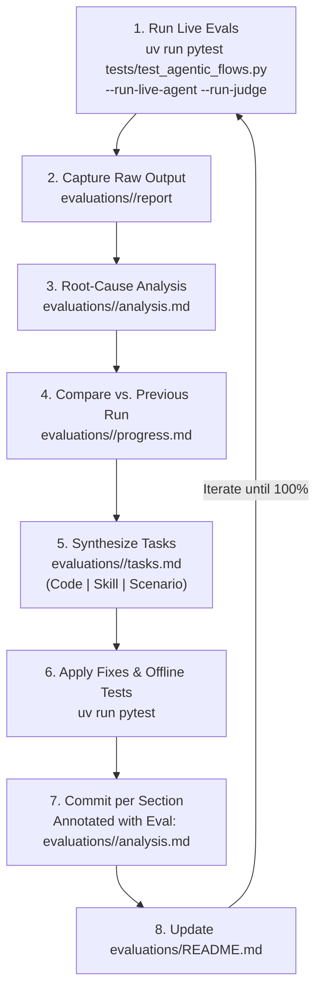

# How to Run the Evaluation-Driven Improvement Loop

This guide documents the repeatable **Evaluate → Analyze → Compare Progress → Propose Tasks → Implement (Traceable Commits) → Re-Evaluate** process used to take the Weather Agent from **5/10 (50%)** to **10/10 (100%)** across all deterministic and LLM-as-a-Judge checks, along with lessons learned and guidelines for future iterations.

---

## 1. Workflow Overview



---

## 2. Directory & Artifact Convention

Every evaluation run lives in its own timestamped directory under `evaluations/` at the project root:

```text
evaluations/
├── README.md                       # Chronological index of all runs & metrics
├── HOWTO.md                        # This playbook
└── <YYYY-MM-DD_HH-MM-SS>/
    ├── report                      # Unmodified raw stdout from pytest
    ├── analysis.md                 # Metrics, evaluator pass rates, and root-cause triage
    ├── progress.md                 # Diff vs. previous run and per-commit impact assessment
    └── tasks.md                    # Actionable checklist grouped by Code / Skill / Scenario
```

---

## 3. Step-by-Step Process

### Step 1: Execute the Evaluation Suite
Run the full live agentic flow suite with LLM-as-a-Judge enabled and save the exact terminal output to `evaluations/<timestamp>/report`:

```bash
uv run pytest tests/test_agentic_flows.py --run-live-agent --run-judge
```

### Step 2: Analyze Results (`analysis.md`)
Record objective metrics and triage every failure without guessing:

1. **Metrics summary:** Git `HEAD`, scenario pass rate (`X/10`), individual check pass rate (`X/60`), deterministic vs. LLM-judge breakdown, and total wall-clock duration.
2. **Per-case & per-evaluator tables:** Identify which evaluators failed (`trajectory_match`, `tool_policy`, `efficiency_budget`, `groundedness`, `trajectory_quality`, `response_quality`).
3. **Root-cause classification:** Explicitly separate every failure into one of four buckets:
   - **Code / Harness / Agent Runtime Bug** (e.g., missing checkpointer, message slicing, tool docstrings, `system_prompt`).
   - **Evaluator / Judge Bug** (e.g., missing multi-turn context, unlabeled turn boundaries, missing empty-response guard).
   - **Skill / Agent Memory Gap** (`AGENTS.md` or `skills/weather/SKILL.md` missing or ambiguous rule).
   - **Scenario Definition Issue** (`evals/datasets/weather_flows.yaml` overly strict, brittle, or contradicting the skill).

### Step 3: Compare Progress (`progress.md`)
Compare the new run against the previous run (and baseline):

1. Show deltas for scenarios passed, individual checks passed, evaluator pass rates, and duration.
2. Provide a scenario-by-scenario diff table highlighting fixes, stable passes, and regressions.
3. Assess **each commit** from the previous cycle honestly: did it achieve its target, did it have zero runtime effect, or did it cause a side-effect regression?

### Step 4: Synthesize Tasks (`tasks.md`)
Derive concrete tasks from **both `analysis.md` and `progress.md`** so fixes account for regressions and prior learnings:

- Always preserve the three-section separation:
  1. **Code Fixes** (`src/`, `evals/`, `tests/`)
  2. **Skill & Agent Memory Updates** (`AGENTS.md`, `skills/`)
  3. **Scenario Updates** (`evals/datasets/weather_flows.yaml`)
- Only modify a scenario when the scenario itself is demonstrably brittle, ambiguous, or contradictory—never weaken assertions to hide a real agent defect.

### Step 5: Implement, Verify Offline, and Commit with Traceability
1. Apply the planned changes and add fast offline unit tests in `tests/test_eval_framework.py` for any code or evaluator fix.
2. Run the offline unit test suite before committing:
   ```bash
   uv run pytest
   ```
3. Make **one individual commit per section** (Code Fixes, Skill Updates, Scenario Updates) and annotate every commit message with the evaluation analysis that triggered it:
   ```bash
   git commit -m "fix: <concise description>" -m "Eval: evaluations/<timestamp>/analysis.md"
   ```
4. Mark completed items `[x]` in `evaluations/<timestamp>/tasks.md` and append the run to `evaluations/README.md`.

### Step 6: Repeat
Re-run Step 1 to verify that the targeted fixes succeeded without introducing regressions. Stop when all scenarios and checks pass cleanly (or add harder scenarios to raise the bar).

---

## 4. Lessons Learned (From Runs 1–10: 50% → 100%)

### 1. Progressive Disclosure (`SKILL.md`) vs. Eager Context (`AGENTS.md` / `system_prompt`)
- **What happened:** In Run 2, editing `skills/weather/SKILL.md` produced **byte-for-byte identical outputs** on failing scenarios because `SkillsMiddleware` uses progressive disclosure and the local LLM called domain tools directly without calling `read_file` on `SKILL.md`.
- **Takeaway:** Always verify whether skills are actually loaded (`Skill loaded (SKILL.md)` diagnostic in `evals/harness.py`). Put critical behavioral invariants in eagerly loaded context (`AGENTS.md` and `system_prompt`) and tool docstrings, while keeping `SKILL.md` in sync.

### 2. Multi-Turn State Requires an Explicit Checkpointer
- **What happened:** In Run 1, `create_weather_agent()` lacked a `checkpointer` (`None`), which broke `thread_id` persistence across turns *and* corrupted `evals/harness.py`'s `messages[prev_count:]` slicing—causing dropped tool calls and empty final responses.
- **Takeaway:** Always pass a checkpointer (e.g., `MemorySaver()`) for multi-turn agents and unit-test both checkpointer presence and multi-turn slicing offline.

### 3. Prompt Bloat vs. Over-Trimming (Find the Minimal Invariant Sweet Spot)
- **What happened:**
  - Appending negative constraints (`NEVER / do NOT`) across Runs 3–7 grew `system_prompt` to ~150 words duplicating `AGENTS.md`, which pushed runtime up to ~10 minutes and caused an empty response (`''`) on `service_outage_error_recovery` (Run 7).
  - Over-trimming `system_prompt` in Run 8 immediately regressed 3 scenarios (#1, #3, #6), proving the local LLM gives higher attention weight to `system_prompt` than to `MemoryMiddleware`-injected `AGENTS.md`.
- **Takeaway:** **Refactor and consolidate rather than appending.** Keep `system_prompt` compact (~80–90 words) with only the proven high-attention invariants (tool pairing, anti-hallucination, no manual unit conversion, explicit tool-error recovery) and let `AGENTS.md` hold the fuller specification.

### 4. Write General, Unambiguous Rules (Avoid Narrow Patches and "Either/Or" Branches)
- **What happened:**
  - Saying *"report both conditions and temperature"* without an anti-hallucination guardrail led the model to fabricate `12°C` on a rain-only query (Run 4).
  - Saying *"never manually convert to unsupported units like Kelvin"* led the model to manually convert °C → °F on a follow-up turn, miscalculating `feels like` as `56.0°F` instead of `55.4°F` (Run 5).
  - Saying *"either ask which unit they prefer or provide Celsius"* caused the model to emit a dangling *"Let me check..."* reply (Run 6).
- **Takeaway:** Generalize rules on the first pass (*"never manually convert between any units"*), pair every *"always include X"* rule with *"never invent X without a tool call"*, and give edge cases **one deterministic action** instead of an open-ended choice.

### 5. Do Not Use Brittle Synonym Lists for Open-Ended Language
- **What happened:** `unknown_city_error_recovery` failed 3 separate times (Runs 1, 3, 7) on completely accurate replies (`"does not match"`, `"could not be found"`, `"is not recognized as a valid city"`) that passed both LLM judges.
- **Takeaway:** Use deterministic `grounded_any_of` / `forbidden_substrings` for **objective factual tokens** (e.g., `"Atlantis"`, `"14°C"`, forbidding `"°C"`/`"°F"` on error cases or `"281.15"` on Kelvin), and delegate open-ended phrasing quality to LLM-as-a-Judge.

### 6. Audit Evaluators & Judge Inputs Early
- **What happened:** Three judge-side issues caused false signals across runs:
  1. `response_quality` passed an empty response (`''`) in Run 1 → fixed with a deterministic empty-response short-circuit.
  2. `response_quality` only received Turn 2's final reply while grading a 2-turn rubric → fixed by passing the full user+assistant conversation (`_format_conversation()`).
  3. `trajectory_quality` received a flat message list without turn numbers and miscounted two sequential tool calls in User Turn 1 as Turn 1 and Turn 2 → fixed by grouping `_format_trajectory()` by explicit user turn.
- **Takeaway:** Whenever an LLM judge disagrees with actual tool calls or responses, inspect the **exact formatted string** sent to the judge and add an offline unit test for the formatter.

---

## 5. Guidelines Checklist for Future Iterations

Before committing changes in a future evaluation cycle, check:

- [ ] **Root cause verified:** Confirmed whether the failure is in agent code, prompt/skill, evaluator, or scenario—never guessed.
- [ ] **No prompt bloat:** Consolidated rules instead of appending duplicate `NEVER` clauses; kept an explicit tool-error recovery invariant.
- [ ] **No ambiguous branches:** Every edge case specifies one concrete behavior.
- [ ] **Deterministic vs. semantic split:** Deterministic checks test facts, tool policy, budgets, and forbidden tokens; LLM judges test tone, clarity, and open-ended phrasing with full turn context.
- [ ] **Offline tests green:** `uv run pytest` passes (with new unit tests for any code/evaluator fix).
- [ ] **Traceable commits:** One commit per section (`Code`, `Skill`, `Scenario`), each annotated with `Eval: evaluations/<timestamp>/analysis.md`.
- [ ] **Index updated:** `evaluations/README.md` links to `analysis.md`, `progress.md`, `tasks.md`, and `report`.
